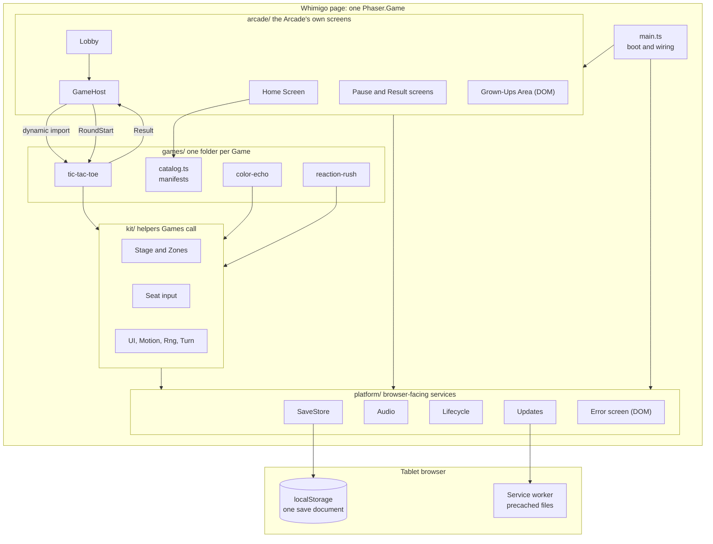
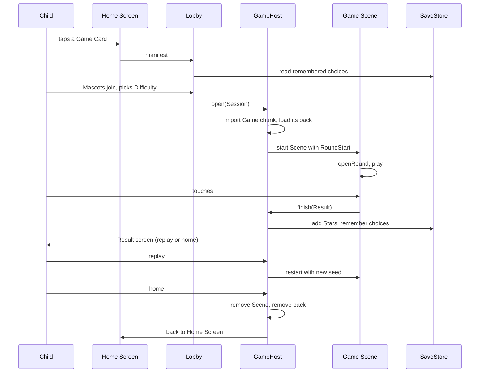
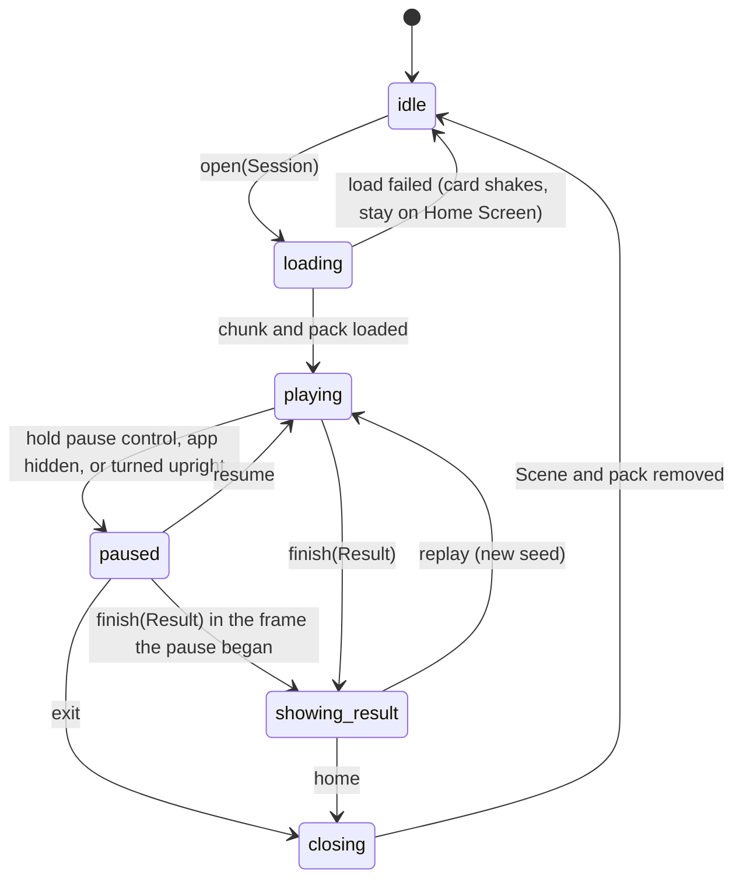
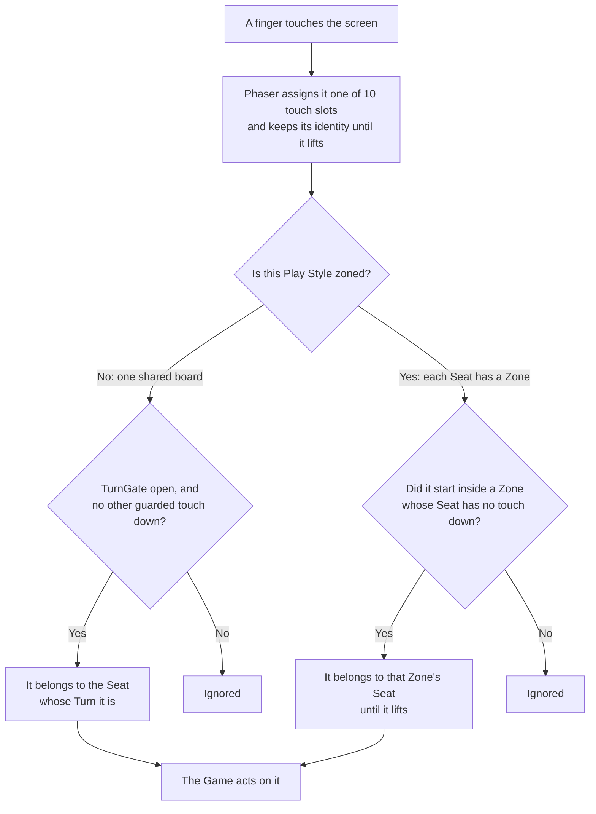

# Architecture Overview

Status: **accepted** on 2026-11-19. Phase 0 is being built; the walking skeleton, the asset build, the Touch Check, the Sound check and the Performance check exist. Terms in **bold** are defined in [CONTEXT.md](../../CONTEXT.md).

## Summary

Whimigo is a single-page, offline web app that runs one Phaser 4 game instance for its whole life. The **Home Screen**, the lobby and every **Game** are Phaser Scenes. Each Game is a folder that is loaded on demand, given a **Session**, and removed when the child goes home. There is no React, no backend, no state library and no rules engine.

| Concern | Decision | Compared with the starting proposal |
|---|---|---|
| Game engine | Phaser 4, pinned exactly at 4.2.1 | Accepted. No blocker found; several defects to design around |
| Application shell | Phaser Scenes. A small plain-DOM layer for the things only adults read | **Changed.** React is rejected |
| Language and build | TypeScript (strict), Vite 8 | Accepted |
| Installation and offline | PWA through `vite-plugin-pwa` (Workbox), everything precached | Accepted, with a strict update rule |
| Local storage | One versioned JSON document in `localStorage` | **Changed.** IndexedDB is rejected |
| Sound | Synthesized from recipes written in code. No audio files and no voice | New, by the owner's decision |
| Art | SVG authored in the repository and packed at build time. No illustrator | New, by the owner's decision |
| Test device and design size | A 13-inch iPad Pro (M5). Its native 2752 × 2064 is the design frame | New, by the owner's decision. Android matters little and is unverified |
| Tests | Vitest for logic, Playwright for the running Arcade, a real-device checklist | Accepted, with scope limits |
| Hosting | GitHub Pages at its default `github.io` address, from a public repository | Accepted. Chosen because the tablet's web filter allows GitHub |
| Not introduced | Three.js, a native wrapper, a backend, a UI library, a state library, a physics engine beyond what Phaser bundles | As requested |

The single biggest risk is not in the software. iPadOS can cancel every touch on the screen when it sees four or five fingers, and web content cannot stop it. Whether four children can play a **Simultaneous** Game on an iPad is decided on the family's iPad Pro in Phase 0, before any Game is written. See [Risks](#risks).

## How sure are we

Every claim in this document falls into one of four groups.

| Group | Meaning | Examples |
|---|---|---|
| **Confirmed** | Read in primary sources: the Phaser 4.2.1 source, WebKit and Apple documentation, MDN | Phaser tracks up to 10 touches and keeps each one's identity until it lifts. Phaser 4 has no device-pixel-ratio support. An installed web app on iPadOS is exempt from Safari's seven-day storage purge. iPadOS ignores the manifest's `orientation` |
| **Assumption** | A design choice that should hold, reasoned but not yet exercised | Lazily imported Scenes can be added and removed cleanly. A reload is an acceptable recovery from an unexpected error. An 88-unit margin keeps controls clear of the status bar |
| **Proof of concept needed** | Cannot be known without running on a real tablet. Phase 0 exists to answer these | Do four simultaneous touches survive on iPadOS? Does a Game's art fit one atlas page at the iPad Pro's resolution? Does sound come back after the app is backgrounded? |
| **Product decision** | Not a technical question. A default is chosen; the owner can change it | **Player** identity is a **Mascot**. **Seating** presets. Whether silent mode is honoured |

Confirmed facts are cited under [Sources](#sources). Assumptions, proofs of concept and product decisions are collected in [Risks](#risks) and [Open decisions](#open-decisions).

## Components



### Module responsibilities

| Module | Owns | Does not own |
|---|---|---|
| `main.ts` | Creating the one `Phaser.Game`, constructing the platform services, registering the service worker, installing the global error handler | Any behaviour |
| `arcade/` | The **Home Screen**, the lobby (who is playing, **Play Style**, **Difficulty**, **Seating**), the pause and **Result** screens, the **Grown-Ups Area**, the `GameHost`, and the rule that turns a Result into **Stars** | Any Game's rules or drawing |
| `platform/` | Everything that touches a browser API: storage, the audio context, visibility and suspension, service-worker updates, safe-area and reduced-motion detection, the fatal error screen | Anything about Games, **Seats** or screens |
| `kit/` | The helpers every Game uses: Stage and **Zones**, seat input, UI controls, motion presets, seeded randomness, **Turn** helpers | Game rules; Arcade screens |
| `games/<id>/` | One Game: its manifest, its pure rules, its Scene, its art and audio | Anything outside its folder |
| `contract.ts` | The shared types in [game-contract.md](game-contract.md) | Runtime code |

The import rules between these are in [game-contract.md](game-contract.md#dependency-rules) and are enforced by lint.

### Why Phaser for the shell and not React

A React shell would mean two rendering systems, two styling systems, two sets of buttons (HTML ones for menus and Phaser ones for the in-game controls), and a bridge between them. React earns that cost when an app has forms, long lists, text input and screen-reader semantics. The Arcade has none of those: children pick pictures, there is no keyboard, and the audience cannot read.

Phaser 4's input handling makes the combination worse than neutral. It listens for touches on the whole window, so a touch on an HTML element still uses up one of the ten touch slots, and it drops finger movement that passes over HTML. Both are confirmed in the 4.2.1 source. With four children touching the screen, HTML laid over the canvas is a liability.

So the rule is: **if a child touches it, it is Phaser.** Plain DOM is used for exactly three things that only adults read and that are easier and sharper as real text: the loading splash, the fatal error screen, and the Grown-Ups Area. They are full-screen, never shown during a **Round**, and need no framework. See [ADR-0001](../adr/0001-phaser-centric-arcade-no-react.md) and [ADR-0005](../adr/0005-pictures-in-canvas-words-in-dom.md).

## State and data flow

There is no global store. Each piece of state has one owner, and data moves by function call along one path.

| State | Owner | Lifetime | Persisted |
|---|---|---|---|
| Settings (sound, reduced motion, last **Seating**) | `SaveStore` | For ever | Yes |
| **Progress** per **Mascot** (**Stars**, later **Achievements**) | `SaveStore` | For ever | Yes |
| Remembered choices per Game (last Play Style, Difficulty, Mascots) | `SaveStore` | For ever | Yes |
| The current **Session** | Lobby creates it; `GameHost` holds it | Until the child returns to the Home Screen | No |
| The current **Round's** state | The Game's own `logic/`, held by its Scene | One Round | No |
| What is on screen | Phaser Scenes | While the Scene runs | No |



A Round in progress is never saved. Rounds last one to three minutes, so if the tablet closes the app, the child restarts from the Home Screen and loses at most that Round. This removes a whole class of serialization and versioning work.

## Game lifecycle

A Game is registered at build time (its manifest is in `catalog.ts`), loaded when opened, and unloaded when closed. Phaser's Scene Manager can add and remove Scenes at run time and can remove every asset listed in a pack in one call; both are confirmed in the 4.2.1 source. The whole Arcade runs in one long-lived `Phaser.Game`, which is never destroyed ([ADR-0002](../adr/0002-one-game-instance-lazy-scenes.md)). Confirmed on 2026-11-19 by an automated test (gate G6): the Performance check adds a Scene and loads the stand-in pack, then removes the Scene and the pack's textures, 50 times, and the Scene, texture and sound counts end where they began with no stand-in texture left, so per-Game unloading stays. On 2026-11-20 the same loop ran to 50 on the iPad Pro, and the owner confirmed the gate.



| Step | What the Arcade does | What the Game does |
|---|---|---|
| Register | Lists the manifest in `catalog.ts` | Provides the manifest |
| Load | `manifest.load()`, then loads the pack while showing the Game Card growing into a loading picture | Nothing |
| Start | Adds the Scene under the Game's id and starts it with a `RoundStart` | Calls `openRound`, builds the board |
| Pause | Pauses the Scene (which stops its timers, tweens and input), pauses sound, shows the pause screen | Nothing; this is why Games must use scene time |
| Resume | Hides the pause screen, resumes sound and the Scene | Nothing |
| Restart | Restarts the Scene with a new seed | Builds a fresh Round |
| Complete | On `finish(Result)`: pauses the Scene, awards Stars, shows the Result screen | Calls `finish` once |
| Unload | Stops and removes the Scene, removes the pack's textures and sounds | Nothing; everything it made belonged to its Scene |

### Only one Scene receives touches

Phaser delivers each touch event to Scenes from the top down, and a Scene that hits an interactive object can stop lower Scenes from seeing other fingers in the same event (confirmed in the source). A heads-up Scene laid over a Game would therefore let one child's finger on the pause button swallow another child's tap.

The rule that follows: **at any moment exactly one Scene accepts input.** The pause control is drawn inside the Game's own Scene by `openRound`. The pause and Result screens are separate Scenes, but they only appear after the Game Scene has been paused. See [ADR-0004](../adr/0004-one-input-scene-at-a-time.md).

### Errors and recovery

| Failure | Response |
|---|---|
| The browser cannot run the Arcade (no WebGL, script failed to load) | The DOM error screen: a picture and one large restart button |
| A Game fails to load (missing chunk or asset) | `GameHost` returns to `idle`. The Game Card shakes its head; the child is still on the Home Screen |
| An unexpected exception anywhere | The global handler shows the DOM error screen. The restart button reloads the page, which comes back from the service-worker cache in a second or two |
| Two unexpected errors within a few seconds of starting | The error screen shows the technical message for an adult, with no automatic retry, so the app cannot loop |
| Storage is missing, full or unreadable | The Arcade runs normally with Progress held in memory. The Grown-Ups Area says that Progress will not be kept |
| A corrupt or newer-than-understood save document | It is set aside under a second key and the Arcade starts with fresh Progress |

Recovery is deliberately coarse. An exception inside Phaser's frame loop stops the loop for good: confirmed on 2026-11-19 in the 4.2.1 source, whose `RequestAnimationFrame` runs the step before it asks for the next frame, so a step that throws never asks. And a paused **Round** is worth at most three minutes of play. Reloading is simpler and more reliable than trying to repair a running game. The last few error messages are kept in memory and shown in the Grown-Ups Area; nothing is sent anywhere.

## Touch and multiplayer

One tablet, up to four children, and no way for the tablet to know whose finger is whose. The design does not try to solve that in general. It gives every touch exactly one **Seat** by one of two rules, and makes everything else the kit's job.



### What is confirmed about Phaser 4 input

- It uses Touch Events, tracks up to **10** simultaneous touches when configured with `activePointers: 10`, and silently ignores an eleventh.
- Each touch keeps the same Pointer object from down to up, matched on the browser's touch identifier.
- There is no cancel event. A touch the system takes away arrives as an ordinary release with `wasCanceled` set. The kit turns this into `canceled: true` so no Game mistakes it for a tap.
- It does not set the CSS `touch-action` property. The page must.
- Nothing changed in the input system between Phaser 3.90 and 4.2.1 apart from gamepad fixes.

### What the page does once, at boot

- `activePointers: 10`, so a resting palm or a fifth finger does not use up the slots four children need.
- `windowEvents: false`, so touches outside the canvas do not consume slots.
- On the root element: `touch-action: none`, `user-select: none` (with the `-webkit-` prefix iPadOS still needs), `-webkit-touch-callout: none`, `overscroll-behavior: none`, a fixed non-scrolling body, and the context menu disabled. Together these suppress pinch and double-tap zoom, text selection, the long-press callout, and Android's pull-to-refresh.
- The app has no history entries, so there is nothing for a back-swipe to go back to.

### What the page cannot do

These are operating-system behaviours with no web API. The Arcade is designed to survive them and the family is told how to turn them off.

| Behaviour | Platform | Effect | Mitigation |
|---|---|---|---|
| Four- and five-finger pinch and swipe | iPadOS | Leaves the app. Open reports say that on iPadOS 26 and 27 these fire even when switched off in Settings, cancelling every touch on screen | Simultaneous Games are built on short taps, never holds or drags. Measured on 2026-11-20 (gate G1): one finger tapping fast in each of four Zones gave no cancellations with default settings, with the gesture toggles off, and with Guided Access on, so four **Seats** play Simultaneously on iPadOS with no setting changed. The family guide recommends Guided Access for play, to keep children in the Arcade, and does not ask for the gesture toggles to be switched off |
| Edge swipes (home, Dock, Control Centre, notifications) | iPadOS | Leaves or covers the app | Nothing a child must touch sits within the 88-unit margin. Guided Access removes most of them |
| Three-finger undo and copy gestures, shake to undo, corner-swipe screenshot | iPadOS | A system banner appears | Switched off in Settings |
| Rotation to portrait | iPadOS | The manifest's `orientation` is ignored and the lock API is unsupported | The Arcade pauses and shows a rotate picture. Guided Access can hold landscape |
| Windowed Apps and Stage Manager | iPadOS 26+ | The app's window can be any size, with system window controls over it | The Stage scales to any size. The family is advised to use Full Screen Apps |
| Low Power Mode | iPadOS | Animation frames drop to about 30 per second | All timing is by elapsed time, never by counting frames |
| A touch limit below 10 | Some budget Android tablets report only 5 | A fifth finger may be dropped, or all touches cancelled | Four Seats at one finger each fit within 5. The Touch Check screen shows what a given tablet really does. Unverified: no Android tablet is available |
| Edge swipes and OEM three-finger screenshot | Android | Reveals system bars or takes a screenshot | `display: fullscreen` in the manifest; app pinning; switch the OEM gesture off |

The browser reports a fixed "5" for the number of touch points on every iPad, so the Arcade cannot detect a tablet's real limit by asking. The **Touch Check** screen in the Grown-Ups Area (on the placeholder Home Screen until that Area is built) shows every live touch and the highest count reached. It is the Phase 0 measuring tool and it stays in the product for exactly that reason.

### Seating and Zones

Children sit beside one another with the tablet propped up, or around the tablet lying flat. The lobby offers the two as pictures and remembers the choice. Defaults: side-by-side for one or two Players, around-the-table for three or four.

- **Shared boards** are drawn with no "up": pieces, cards and boards read the same from any side. The **Turn** indicator is a large pointer in the **Seat's** colour and shape that moves to that Seat's edge of the screen.
- **Zones** come from the kit. In around-the-table **Seating** the far Zones face 180°, and a Game draws each Zone's content once into a container the kit has already placed and rotated. Zone positions are tabulated in [game-contract.md](game-contract.md#stage).

### Preventing accidents

- Pausing needs a deliberate hold of about half a second on the pause control, which fills a ring while held. A brush does nothing.
- The pause control sits halfway down a short edge of the screen, away from every Zone, from the iPadOS home indicator at the bottom and from the status bar at the top.
- The **Grown-Up Gate** is a three-second hold. Its purpose is to prevent accidents, not to keep out a determined eight-year-old.
- Nothing a child can reach deletes anything. Resetting Progress is in the Grown-Ups Area and asks twice.
- While an animation plays or a **Computer Player** is choosing, the `TurnGate` is closed and taps are ignored, so an impatient double-tap cannot make two **Moves**.

## Screen and layout

Phaser 4 has no device-pixel-ratio support: the canvas has exactly as many pixels as the game's logical size, and CSS stretches it (confirmed). The one known workaround, sizing the canvas per device and zooming the camera to match, has an open defect report against it. So the Arcade uses one fixed design size and lets Phaser scale it ([ADR-0003](../adr/0003-fixed-design-frame.md)).

- **Design frame:** 2752 × 2064 units, 4:3. This is the native resolution of the family's 13-inch iPad Pro, so one unit is one screen pixel there. The frame is always fully visible.
- **Scale mode:** `EXPAND`. On a screen wider than 4:3 the canvas grows sideways (to about 3302 × 2064 at 16:10) and the design frame stays centred. The extra width shows backdrop only.
- **Why this size:** the owner's decision ([ADR-0003](../adr/0003-fixed-design-frame.md)). The iPad Pro is the tablet the Arcade is made for and it has power to spare. Art made for the largest screen scales down cleanly to smaller ones; the reverse would not be true.
- **The cost:** every tablet draws the full frame, whatever its screen. An 11-inch iPad draws about 60% more pixels than it shows, which it can afford. A typical 1920 × 1200 Android tablet would draw about three times as many, with texture memory to match. Android matters little to this project, so that cost is accepted without being measured.
- **Smaller iPads:** nothing extra is needed. An iPad mini draws about twice the pixels it shows, which it handles easily. What changes there is physical size: everything is about 56% as large as on the iPad Pro. Sizes are therefore judged at the smallest supported screen, the 8.3-inch mini.
- **A lighter mode, kept possible but switched off:** the kit holds one hidden number, the render scale, fixed at 1. At 0.5 the canvas has half the pixels each way and every Scene's camera is zoomed to match; Games work only in design units, so they do not change. Phase 0 tested whether this works in Phaser 4.2.1 by tapping the same targets at both scales, so giving a slow tablet a lighter mode later is a change in one place. Confirmed on 2026-11-19 by that test (gate G8): at 0.5 every named target of the Home Screen and of every check screen is within one CSS pixel of where it is at 1, a press there does the same thing, and four touches in four Touch Check Zones count one each. Only a test can ask for it, with `scale=0.5` beside the test bridge's `e2e=1` in the address; the mode stays switched off, as the owner confirmed on 2026-11-20. The test runs in Chromium only and compares positions and presses, not pixels, so switching the mode on for a real tablet first needs a check on that tablet.
- After Phase 1 the frame size itself is expensive to change.
- **Safe area:** `stage.safe` is the design frame inset by the larger of the reported safe-area inset and a fixed 88 units (about 8 mm on the iPad Pro). The fixed margin exists because iPadOS currently has an open defect in which installed web apps report an inset of zero while still drawing a status bar. On the iPad Pro, iPadOS 27.2, on 2026-11-20 (gate G5), the installed app behaved differently: despite `display: fullscreen` and `viewport-fit=cover`, iPadOS placed the page below the status bar (a 1376 × 1000 window in landscape), so nothing is drawn under it, and the bottom inset was 25 CSS pixels, about 52 units. The fixed margin therefore governs on every side, nothing a child must touch was hidden, and it stays at 88.
- **Resize:** the design frame never changes, so Games ignore resizing. Only the backdrop follows the screen, and the kit does that.
- **Portrait:** the Arcade pauses and shows a rotate picture. Portrait means the canvas is taller than it is wide. The picture covers whatever was showing, which waits beneath it, paused, and shows again once the screen is back on its side; a Round that was running comes back on the pause screen.

## Storage

**Progress** and settings together are a few kilobytes with no need for queries. They are stored as one versioned JSON document in `localStorage`, under a key beginning `whimigo:`, behind a `SaveStore` that the rest of the app talks to ([ADR-0007](../adr/0007-progress-in-localstorage.md)).

```ts
interface SaveDocument {
  version: 1;
  settings: {
    sound: boolean;
    reducedMotion: 'system' | 'on' | 'off';
    seating: Seating;
  };
  mascots: Record<MascotId, { stars: number }>;
  games: Record<GameId, {
    playStyle?: PlayStyle;
    difficulty?: Difficulty;
    mascots?: MascotId[];
    roundsPlayed: number;
  }>;
}
```

- **Why not IndexedDB.** WebKit evicts an origin's data all together: IndexedDB, the service-worker cache and `localStorage` go at once (confirmed). IndexedDB is therefore no safer, and it brings an asynchronous start-up, a history of WebKit defects, and writes that can be lost if the app is killed mid-transaction. A synchronous write after each Round has none of those problems.
- **Durability.** An installed web app on iPadOS is exempt from Safari's seven-day purge of unused site data and keeps its data separately from Safari (confirmed). The Arcade also asks for persistent storage at start-up. In a plain Safari tab the purge does apply, so the Grown-Ups Area says when the Arcade is not installed.
- **Honesty about loss.** Clearing website data, or clearing Chrome's data on Android, erases Progress. Progress is Stars and stickers; nothing is unrecoverable in a way that matters. Export and import are not built.
- **Versioning.** The document carries a version. Loading runs migrations up to the current version, validates the result, and falls back to fresh Progress if anything is wrong.
- **Unavailable storage.** `SaveStore` reports `persistent`, `best-effort` or `memory-only`, and the Arcade works in all three.

## Offline, installation and updates

The Arcade is a PWA built with `vite-plugin-pwa`. See [ADR-0008](../adr/0008-precache-everything-update-at-safe-points.md).

- **Precache everything.** The service worker caches every file at install: the engine, every Game's chunk and every atlas. After the first visit the Arcade never needs the network. This is simpler and safer than caching Games as they are first opened, which would leave a Game unavailable on a car journey because nobody happened to open it at home. Two Workbox defaults must be overridden, because by default it precaches only scripts, styles and HTML and skips files over 2 MiB.
- **Budget.** At most 60 MB in total and 5 MB per Game. The Grown-Ups Area shows "ready to play offline" once the service worker has finished.
- **No media to cache.** Sound is synthesized, so there are no audio files, and the cached-media problems Safari has with them do not arise.
- **Updates never interrupt play.** The service worker is registered in prompt mode. A new version downloads in the background and waits. It is applied in one of two ways: automatically the next time the Arcade is started cold, or when an adult presses "Update now" in the Grown-Ups Area. It is never applied during a **Session**. Because every file name contains a content hash and a version is cached as a whole, a running Arcade can never mix files from two versions.
- **Checking for updates.** A long-lived installed app rarely reloads, so the Arcade asks the service worker to check whenever it becomes visible again.
- **Installing.** On iPadOS: Share, Add to Home Screen, with "Open as Web App" on (the default since iPadOS 26). On Android: Chrome's Install app. There is no install prompt API on iPadOS, so the Grown-Ups Area shows the steps as pictures when the Arcade is running in a browser tab.
- **Manifest.** `display: fullscreen` (iPadOS falls back to `standalone`), `orientation: landscape` (honoured on Android only), icons at 192 and 512 pixels, plus an `apple-touch-icon`.
- **Hosting.** GitHub Pages at the account's default address, `https://<account>.github.io/whimigo/`, published by a workflow on every push to `main` ([ADR-0013](../adr/0013-github-pages-default-address.md)). The Arcade therefore lives under the path `/whimigo/`, which is the build's base path and the scope of the manifest and the service worker.
- **The address matters.** Storage and installation both belong to the site's address. Moving the Arcade later would reset every child's Progress and require reinstalling. The owner has accepted that cost, because the tablet's web filter allows GitHub and might block an address of the owner's own.
- **The hostname is shared** with any other Pages site under the same account, and browsers key stored data by hostname. The save document's `whimigo:` key prefix keeps the Arcade's data apart.

## Suspension and resumption

| Event | What happens |
|---|---|
| The app is hidden (home gesture, app switch, screen lock) | Phaser pauses its loop on its own (confirmed). The Arcade also puts a running Round into `paused` and pauses sound |
| The app returns, still in memory | The pause screen is showing. Its large play button is a real tap, which is what browsers require before sound may resume. Stale touch slots are reset |
| The tablet closed the app while hidden | The page reloads from cache and starts at the Home Screen. The Round is lost; Progress is not |
| The graphics context is lost and restored | Phaser rebuilds its textures (confirmed), except for dynamically drawn ones, which is one reason Games may not use them |

## Sound

- **Everything is synthesized.** There are no audio files and no speech. A sound is a recipe: a few lines of data naming a waveform, a pitch that may glide, and a loudness envelope, optionally several notes in sequence. Recipes live in code beside whatever uses them ([ADR-0014](../adr/0014-synthesized-sound-no-voice.md)).
- **Why.** Through the first release the project keeps human production work low ([ADR-0016](../adr/0016-art-and-sound-made-in-code.md)). A recipe can be written, reviewed and tuned by a coding agent; a recording cannot. It also removes audio formats, decoding defects and cached-media handling from the design.
- **How it plays.** When a recipe is loaded it is rendered once into a sound buffer and given to Phaser's Web Audio sound manager, which then plays, pauses and mutes it like any other sound. Games reach sound only through `RoundAudio`. Whether Phaser 4.2.1 accepts a ready-made buffer in its cache is an assumption checked in Phase 0; the fallback is for `platform/audio` to play the buffers itself on the same audio context. Confirmed on 2026-11-19: it does (its `WebAudioSound` takes the buffer from `game.cache.audio` by key), so the Sound check plays every sound through Phaser's sound manager and the fallback is not built.
- **No voice.** How to play is shown by a wordless **Demo**: an animated hand performs the first few actions, and a child can replay it from the pause screen. Recorded speech is a possibility for Phase 4.
- **Unlocking.** Browsers keep audio silent until a real tap. The first screen is a "tap to start" picture, and that tap unlocks sound. Until then, and whenever sound is switched off, sound calls do nothing and return at once, so no Game can stall waiting for a sound.
- **Hiding and returning.** While the page is hidden, `platform/audio` suspends the audio context and keeps Phaser's sound manager from resuming it on every frame. When the page returns, Phaser tries to resume it on its own (its workaround for iPadOS), and a browser may refuse that without a tap; any tap anywhere resumes it inside the gesture, as it does after the tablet interrupts sound. While sound is not running, a request to play does nothing.
- **Silent mode is respected.** If the tablet is set to silent, the Arcade is silent. The Grown-Ups Area says so when sound seems to be missing.
- **No background music** in the first release. It is the kind of thing that is easy to add and hard to make pleasant for the adults in the room.
- **Known platform defect.** There is an open WebKit report of installed web apps going silent after being backgrounded on iPadOS 26. It did not reproduce on the family's iPad Pro, iPadOS 27.2, on 2026-11-20 (gate G4): in the installed app, sound worked after 10 seconds in the background, after more than a minute locked, and after closing and reopening. So the simple resume-on-tap design stays and the fallback is not built. The fallback, should silence after backgrounding ever be seen on a later iPadOS, is to reload the Arcade when it next returns to the Home Screen. Whether Phaser resumed sound on the tablet before any tap, as it does in Chromium, was not observed; either way a tap brings it back.

## Assets

- **Sources live with their Game**: `games/<id>/art/` for pictures and `games/<id>/sounds.ts` for sound recipes. The Arcade's own art and sounds are under `arcade/`.
- **Art is authored as SVG, in the repository, by coding agents.** SVG is resolution-independent, small, reviewable in a diff, and can be written and edited without a drawing tool. Through the first release there is no other source of art ([ADR-0016](../adr/0016-art-and-sound-made-in-code.md)).
- **One atlas per Game, built by a script.** On mobile, Phaser 4 draws with one texture per batch (confirmed), so every separate image costs a draw call, and there is an open defect that makes frequent batch breaks slow in Chrome. A small build script rasterises each Game's sources at the design resolution and packs them into one atlas, plus one for the Arcade ([ADR-0011](../adr/0011-svg-sources-atlas-per-game.md)).
- **Keys are namespaced by Game id**, and a Game lists its assets in one pack. A frame is keyed `${gameId}/…` and lives in the texture named by the part before the `/`, so a Game's one atlas is the texture `${gameId}` itself; every other key a Game owns starts with `${gameId}/` (decided on 2026-11-20; the rule is in [game-contract.md](game-contract.md#asset-keys)). The Arcade loads the pack when the Game opens and removes it when the Game closes, so memory does not grow as a child moves between Games.
- **No runtime network requests.** No font is downloaded or bundled: the canvas draws its own glyphs and the HTML screens use the device's typeface. Nothing is loaded from a CDN.

## Visual system

One look across all Games, with room for each Game to have its own theme.

| Element | Decision |
|---|---|
| **Tokens** | One `theme.ts`: colours, the four Seat colours with their paired shapes, corner radii, spacing, sizes, durations. Games use tokens, not literal values |
| **Seat identity** | Each Seat has a colour **and** a shape (circle, square, triangle, star). The four colours are chosen to stay distinct under the common forms of colour blindness, and the shape is always shown with the colour |
| **Touch targets** | Minimum 256 units square, standard button 344, at least 64 units between targets. On the 13-inch iPad Pro a unit is about 0.1 mm, so the minimum is about 25 mm; on an 11-inch iPad, where the frame is scaled down, it is about 20 mm, and on an iPad mini about 14 mm. The mini is the size these numbers are chosen for: 14 mm is still well above the 7 to 9 mm usually recommended for adults. These are deliberately far larger than adult guidelines |
| **Controls** | Built only through the kit's UI functions (`button`, `iconButton`, `holdButton`, `panel`, `seatBadge`, `turnPointer`), which apply the minimums. Rounded shapes, a squash on press, a sound on release. A rim rather than a soft shadow: the [style guide](../design/style-guide.md) (2026-11-20) keeps colour flat |
| **Words in the canvas** | As few as possible. Where needed (digits, a Game's title), glyphs drawn as SVG in the repository, in the Arcade's atlas, put together by the kit. Phaser's `Text` object is not used: it has open rendering defects on older iPadOS and when rotated, and every instance costs a draw call on mobile |
| **Words for adults** | Real HTML text in the Grown-Ups Area, in the device's own typeface |
| **Style** | Flat colour, bold outlines, rounded geometric forms and a limited palette: a look that simple vector shapes do well. A written style guide is the first art task of Phase 1, and every **Mascot** and Game is drawn to it |
| **Typeface** | None bundled (decided 2026-11-20). Canvas glyphs are drawn to the style guide; HTML uses the device's typeface. A bundled face would come from outside the repository, which [ADR-0016](../adr/0016-art-and-sound-made-in-code.md) rules out |
| **Motion** | Named presets in the kit: `pop`, `bounce`, `wiggle`, `slide`. Screen changes use one shared transition |
| **Reduced motion** | Follows the device setting, with an override in the Grown-Ups Area. Decorative motion is removed; motion that carries meaning is shortened |
| **Feedback** | Every accepted touch gets a visual and an audible response within one frame. An ignored touch gets a gentle visual one and no sound, so a child learns what works without being scolded |
| **Per-Game themes** | A Game chooses a backdrop and an accent colour from the tokens and brings its own art. It does not restyle the shared controls |
| **Mascots** | The **Mascots** appear on the Home Screen, in the lobby, as Seat badges and on the Result screen. They are what makes separate Games feel like one place |

No home-screen mockup was found in the repository. If one exists elsewhere, it should be added under `docs/design/` and used as the reference for the Arcade's atlas.

**All art is drawn in code, and that is the largest risk to "beautiful and polished".** Vector art written by a coding agent can be clean and charming if the style is chosen to suit it, and poor if it reaches for detail it cannot carry. The style guide exists to keep it on the right side of that line. The owner's part is to look and say what should change.

## Build, dependencies and tooling

| Area | Choice | Note |
|---|---|---|
| Package manager | npm | The simplest thing that works |
| Runtime dependencies | `phaser@4.2.1` and nothing else | Pinned exactly, not with a range ([ADR-0012](../adr/0012-pin-phaser-exactly.md)) |
| Build | Vite 8, `vite-plugin-pwa` 2 | One chunk per Game through dynamic import. Base path `/whimigo/` |
| Hosting | GitHub Pages, deployed by a GitHub Actions workflow on every push to `main` | The repository is public |
| Language | TypeScript, strict | Phaser's own type definitions are the reference for its API |
| Lint and format | ESLint with `typescript-eslint`, Prettier | Carries the import rules and the bans on wall-clock time and `Math.random()` in Games |
| Unit tests | Vitest 4 | Node environment; no browser, no Phaser |
| Browser tests | Playwright | Against the production build |
| Asset build | One Node script using `sharp` and a rectangle packer | Runs before `dev` and `build` |
| CI | GitHub Actions: type-check, lint, unit tests, browser tests on every push to `main`; then the tested build is published to GitHub Pages and the published `build.json` is checked for the pushed commit | Agents run the same checks before pushing ([ship style](../agents/ship-style.md)) |
| Scaffolding | By hand | The official Phaser templates send a usage ping to a third-party server from their `dev` and `build` scripts, which conflicts with the no-analytics requirement |

Phaser 4.2.1 is about 350 KB compressed and cannot be tree-shaken (confirmed). That is acceptable: it is downloaded once and precached.

**Phaser 4 is new and its release pace has slowed.** Version 4.0 shipped in April 2026 and 4.2.1 in July 2026; there has been no release and no commit to the main branch since August 2026, while defect reports continue to arrive. The Arcade therefore pins the exact version, avoids the features with open defects, and treats an upgrade as a deliberate task with a full device check. If a defect must be fixed locally, `patch-package` is the mechanism. None of this is a reason to choose a different engine.

## Performance and memory

Proposed budgets, to be confirmed or changed by measurements. Phase 0 confirmed the work-per-frame budget on 2026-11-20 (gate G2); the others are still proposed.

The only test tablet is a 13-inch iPad Pro with an M5, which is far faster than an ordinary family tablet and will not reveal a performance problem a slower one would have. So the frame-rate budget is stated as time spent per frame, which leaves a visible margin, and not as "it felt smooth". The margin is a rule of thumb, not a measurement of any other tablet.

| Budget | Target |
|---|---|
| Work per frame in a Round, on the iPad Pro | Under 3 milliseconds, well inside the 16.7 available at the 60 frames per second WebKit gives an installed web app on the iPad Pro (and inside the 8.3 available should it ever run at 120), leaving room for Low Power Mode, heat and older iPads. The Performance check measures it under a standard load of 200 moving token-sized sprites from one atlas, four times the pictures of the busiest planned Round: the time from Phaser's `prestep` event to its `postrender` event, averaged over at least a second. Confirmed on 2026-11-20 (gate G2): about 0.33 ms at a steady 60 frames per second, and about 0.65 ms at a steady 30 in Low Power Mode. This is CPU time; a steady frame rate with no dropped frames is the only sign that drawing keeps up. 60 frames per second is accepted as the normal rate; the Arcade does not try to reach 120 |
| Cold start, offline, to the Home Screen | Under 3 seconds |
| Opening a Game from the Home Screen | Under 1.5 seconds |
| A Game's chunk and assets | At most 5 MB |
| Whole precache | At most 60 MB |
| Opening and closing every Game 20 times | Texture count and Scene count return to where they started |

Rules that follow from confirmed engine behaviour:

- One atlas per Game; avoid interleaving many textures. Atlas pages are at most 4096 × 4096, and a Game has one page. Confirmed on 2026-11-20 (gate G3): art rasterised for the design frame is sharp on the iPad Pro, and a stand-in Game-sized set covering 1.15 times the frame's area packs into one 2048 × 3774 page, under half a page's area. A set that needs a second page fails the build with its name.
- Download size is not texture memory. Decoded, a page takes four bytes a pixel: the stand-in page about 31 MB, a full 4096 × 4096 page about 67 MB. Only one Game's pack is loaded at a time, so there is no separate texture-memory budget.
- Backdrops are flat fills or small tiling frames, never full-screen images. One image the size of the design frame is about 23 MB of texture memory.
- No `Text`, `RenderTexture`, `DynamicTexture` or `Shader` objects in Games.
- One `Phaser.Game` for the life of the page. Destroying and recreating it leaks through a listener Phaser never removes.
- Time by elapsed milliseconds, never by frame count, so 30, 60 and 120 frames per second all play the same. The iPad Pro's display runs at up to 120 Hz, but Safari and installed web apps normally hold animation frames to 60, and a page cannot ask for more; Low Power Mode drops them to 30 (both seen on 2026-11-20). 120 remains possible if WebKit lifts that cap, so all three can occur.

## Accessibility

The audience shapes what accessibility means here. A screen reader cannot read a canvas, and the players cannot read either, so the design leans on the things that help a four-year-old and a child with a motor, visual or hearing difference alike.

- Nothing depends on reading, or on understanding speech.
- Nothing depends on colour alone, or on sound alone.
- Targets are very large and well separated.
- No action needs two fingers, a drag, a double tap or precise timing, except where timing is the Game (Reaction Rush), and that Game has an Easy level with no decoys.
- No time limits on **Turn-Based** Games.
- Reduced motion is honoured.
- Every Game is explained by its **Demo**, which can be replayed.
- The Grown-Ups Area is real HTML and works with a screen reader.

## Constraints and trade-offs

| We chose | We gave up | Why it is worth it |
|---|---|---|
| Phaser for all child-facing screens | Easy HTML layout and screen-reader semantics for menus | One rendering system, one input path, no bridge; the menus are a handful of large pictures |
| One fixed design size, the iPad Pro's | A light drawing load on smaller and slower tablets | Games use plain numbers for positions, and art is as sharp as the main tablet allows. The alternative has an open engine defect |
| `localStorage` | Room to grow into large or structured data | Nothing here is large or structured |
| Precache everything | A small first download | Offline is guaranteed, with no "this Game is not downloaded" state |
| Reload on unexpected error | The Round in progress | Recovery that always works |
| No saved Rounds | Resuming a Round after the tablet closes the app | Rounds are three minutes long |
| No generic rules engine | A single place to add features to all Games | The Games are too different; each stays small and readable ([ADR-0009](../adr/0009-pure-rules-no-generic-engine.md)) |
| A web app, not a native wrapper | The ability to block system gestures | No app-store accounts, signing or review; the gesture risk is handled by settings and by Game design |
| Pinned Phaser 4 | Automatic fixes | Predictable behaviour on a young engine |
| Synthesized sound and no voice | Rich recorded effects and spoken guidance | No production work by a person; no audio files, formats or decoding to go wrong |
| Art drawn in code | An illustrator's hand | The Arcade can be built and changed without waiting on anyone |
| Testing on one iPad Pro | Any real knowledge of Android behaviour | It is the tablet the family has |

A native wrapper is the one alternative worth naming, because it is the only thing that could block iPadOS system gestures in software. It is not recommended: it adds Xcode, signing, a developer account and a second platform to build for. It becomes worth reconsidering only if Phase 0 shows that four-child play on an iPad is impossible any other way and that limit is unacceptable. Phase 0 showed it is possible (gate G1, 2026-11-20), so a wrapper is not needed for this.

## Risks

| # | Risk | Likelihood | Impact | Response | Settled by |
|---|---|---|---|---|---|
| 1 | iPadOS cancels all touches when it sees four or five fingers, even with the gesture switched off | Low. Settled on 2026-11-20 (gate G1): on the iPad Pro, iPadOS 27.2, fast taps with one finger in each of four Zones gave no cancellations under default settings, with the gesture toggles off and with Guided Access on. Sliding fingers and long holds were not tested, and Simultaneous Games do not use them | Four-Seat Simultaneous play is unreliable on iPad | Tap-only Simultaneous Games; four Seats in Simultaneous play on iPadOS; the family guide recommends Guided Access | Phase 0 device test, 2026-11-20 |
| 2 | Android behaviour is unverified, because only an iPad is available: touch limits, speed and full-screen behaviour could all surprise | Medium | The Arcade works less well, or not at all, on some Android tablet. Accepted: Android matters little to this project | Chromium tests cover layout and logic; the Touch Check and performance screens are ready to run if a tablet turns up | Accepted by the owner |
| 3 | The 2752 × 2064 frame is heavy on slower tablets | Low on any iPad, including the mini; high on budget Android | Slow drawing and high texture memory there | Flat fills for backdrops; atlas pages capped at 4096; a render scale kept in reserve if Phase 0 shows it works | Phase 0 automated test, then accepted |
| 14 | Four children do not fit around an 8-inch iPad mini | Medium, if minis are used | Simultaneous play is cramped; Zones are about 58 by 43 mm | Sizes chosen for the mini; side-by-side Seating; treat the mini as best for one or two Players | When a mini is tried |
| 4 | Sound stays silent after the installed app is backgrounded (open WebKit report) | Low. Did not reproduce on iPadOS 27.2 on 2026-11-20 (gate G4); a later iPadOS could bring it back | A silent Arcade until restart | Resume on the pause screen's tap. The reload-at-Home-Screen fallback is described but not built | Phase 0 device test, 2026-11-20; recheck at each device run |
| 5 | Status bar or window controls cover the top of the screen (open WebKit report) | Low. On iPadOS 27.2 on 2026-11-20 (gate G5) the installed app's page started below the status bar and nothing was hidden, in full screen or in Windowed Apps | Hidden or untouchable controls | Fixed 88-unit margin; nothing important at the top edge; advise Full Screen Apps | Phase 0 device test, 2026-11-20 |
| 6 | A Phaser 4 defect blocks something and upstream does not fix it | Medium. On 2026-11-20 (gate G7) Phaser 4.2.1 drew correctly and did not crash on the iPad Pro; one sizing gap when the installed app turns to portrait is worked around in `src/main.ts` ([ADR-0012](../adr/0012-pin-phaser-exactly.md)) | Local workaround needed | Exact pin; avoid known-defective features; `patch-package`; recheck items 13 and 14 on any upgrade | Ongoing |
| 7 | Memory grows as Games are opened and closed | Low | The tablet closes the app | Per-Game packs removed on close; automated open-and-close test; banned leaky object types | Phase 0 and CI |
| 8 | Progress is lost (website data cleared, or played in a Safari tab) | Low | Stars reset | Install guidance; persistent-storage request; honest wording in the Grown-Ups Area | Accepted |
| 9 | An update is applied mid-Session | Low | A Round is interrupted or files mismatch | Prompt mode; apply only at cold start or by an adult | Design, plus a browser test |
| 10 | Art drawn in code and synthesized sound fall short of "beautiful and polished" | Medium | The Arcade works but charms less than hoped | A style chosen to suit vector shapes; a written style guide; the owner's review at each phase; hand-made art and recorded sound remain open for Phase 4 | The owner's review |
| 13 | With no speech and no reading, a Game's rules are not understood from its Demo | Medium | A child does not know what to do | Keep rules simple enough to show; replayable Demo; watch a child try each Game | Phase 1 review |
| 11 | A four-year-old cannot compete with an eight-year-old | High | Frustration | Luck-based and Cooperative Games in the catalog; a per-Seat handicap later | Play testing |
| 12 | The tablet's web filter blocks the `github.io` address | Low now: the address loaded on the tablet on 2026-11-19. The filter's rules could change later | The Arcade cannot be reached or updated; an installed copy keeps working offline | The owner's own server is the fallback | Checked once; recheck if loading ever fails |
| 15 | The tablet is managed by someone else, and Add to Home Screen, the gesture settings or Guided Access are locked | Low. Confirmed on 2026-11-19: the page installs to the Home Screen and opens as an app, and Guided Access can be switched on. Confirmed on 2026-11-20: the Multitasking & Gestures toggles can be switched off, though gate G1 showed they need not be | No installed app, or no way to tame the four-finger gestures | Check all three on the tablet at the start; play in a Safari tab if installing is blocked; cap Simultaneous play at three Seats if the gestures cannot be switched off | The same check |
| 16 | The hosting address changes later | Low | Progress lost, reinstall needed | Accepted by the owner | Accepted |

## Open decisions

Each has a default the design already supports. None needs an answer before work starts.

| # | Decision | Default | Changes what |
|---|---|---|---|
| 1 | How Players are identified | A **Player** is their **Mascot**; no names, no profiles to create | The save document and the lobby |
| 2 | Seating presets | Side-by-side and around-the-table, chosen in the lobby | Zone positions only |
| 3 | Whether to honour silent mode | Yes | One line in `platform/audio` |
| 4 | Star rules | One Star for finishing a Round, one more for winning or succeeding together | One function in `arcade/` |

Settled by the owner on 2026-11-19:

- The test tablet is a 13-inch iPad Pro (M5). Android matters little in practice.
- The design frame is the iPad Pro's native 2752 × 2064.
- Hosting is GitHub Pages at its default address, from a public repository. Losing Progress if the address ever changes is acceptable.
- There is no voice. All sound is synthesized.
- Human involvement is kept low through Phase 3, so art is drawn in code as well.

## Sources

Primary sources for the confirmed claims above. Retrieved 2026-11-19.

**Phaser 4**

- Source at tag v4.2.1: <https://github.com/phaserjs/phaser/tree/v4.2.1> (input: `src/input/`; scale: `src/scale/`; scenes: `src/scene/`; loader: `src/loader/`; sound: `src/sound/`; renderer: `src/renderer/webgl/`)
- Migration guide from v3: <https://github.com/phaserjs/phaser/blob/v4.2.1/changelog/v4/4.0/MIGRATION-GUIDE.md>
- Release history: <https://registry.npmjs.org/phaser>
- Open defects referred to: text on iPadOS 16.4 and earlier [#7392](https://github.com/phaserjs/phaser/issues/7392), rotated quads [#7372](https://github.com/phaserjs/phaser/issues/7372), batch-break cost [#7414](https://github.com/phaserjs/phaser/issues/7414), high-DPI camera zoom [#7351](https://github.com/phaserjs/phaser/issues/7351), listener leak on destroy [#7340](https://github.com/phaserjs/phaser/issues/7340), texture and shader leaks [#7379](https://github.com/phaserjs/phaser/issues/7379) [#7394](https://github.com/phaserjs/phaser/issues/7394)

**iPadOS and Safari**

- Storage policy and eviction: <https://webkit.org/blog/14403/updates-to-storage-policy/>
- Seven-day purge and the installed-app exemption: <https://webkit.org/tracking-prevention/>
- Multitasking and gesture settings: <https://support.apple.com/guide/ipad/change-multitasking-gestures-settings-ipad-ipad2q9j404h2/27/ipados/27>
- Guided Access: <https://support.apple.com/en-us/111795>
- Reports of multi-finger gestures firing while disabled: <https://developer.apple.com/forums/thread/853481>, <https://developer.apple.com/forums/thread/795102>
- Safe-area inset defect in installed web apps: <https://bugs.webkit.org/show_bug.cgi?id=301994>
- Silent audio after backgrounding: <https://bugs.webkit.org/show_bug.cgi?id=291892>
- Installing as a web app: <https://support.apple.com/guide/ipad/open-as-web-app-ipad8f1f7a29/27/ipados/27>
- Low Power Mode frame rate: <https://bugs.webkit.org/show_bug.cgi?id=215745>

**Web platform**

- Manifest `display` and `orientation` support: <https://developer.mozilla.org/en-US/docs/Web/Progressive_web_apps/Manifest/Reference/display>, <https://developer.mozilla.org/en-US/docs/Web/API/ScreenOrientation/lock>
- Touch identity: <https://developer.mozilla.org/en-US/docs/Web/API/Touch/identifier>
- Chrome install criteria: <https://web.dev/articles/install-criteria>
- Persistent storage: <https://web.dev/articles/persistent-storage>
- Precache defaults: <https://vite-pwa-org.netlify.app/guide/service-worker-precache>
- Update strategies: <https://vite-pwa-org.netlify.app/guide/auto-update>, <https://web.dev/learn/pwa/update>

**Testing tools**

- Playwright touch support: <https://playwright.dev/docs/api/class-touchscreen>, <https://playwright.dev/docs/touch-events>
- Multi-point touch through the DevTools protocol: <https://github.com/ChromeDevTools/devtools-protocol/blob/master/pdl/domains/Input.pdl>
